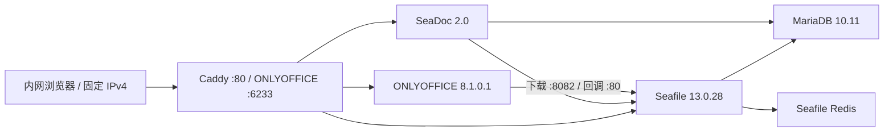

# 架构与持久化边界

六个 Compose 服务是 `db`、`redis`、`seafile`、`caddy`、`onlyoffice`、`seadoc`。ONLYOFFICE 容器内部有自己的 PostgreSQL、RabbitMQ、Redis 状态，不能与 Seafile 的 Redis 混淆。

| 数据 | 目标位置或卷 |
| --- | --- |
| 部署配置和补丁 | `/opt/seafile` |
| Seafile 资料库与配置 | `/opt/seafile-data` |
| MariaDB 物理数据 | `/opt/seafile-mysql/db` |
| ONLYOFFICE bind 数据/日志 | `/opt/onlyoffice` |
| 自定义字体 | `/opt/onlyoffice-fonts` |
| Caddy | `/opt/seafile-caddy` |
| SeaDoc | `/opt/seadoc-data` |
| ONLYOFFICE 内部数据 | PostgreSQL / RabbitMQ / Redis 三个 external 卷 |

首次恢复的 RabbitMQ hostname 固定为备份中的 `05831744982c`；保留数据升级须发现并复用原节点身份与卷名。卷内容与 hostname 不匹配可能使 RabbitMQ 丢失原节点状态。

浏览器访问 IP，服务间以 `http://seafile` 和 `http://seafile:8082` 通信。SeaDoc API 和 WebSocket 通过 Caddy 的 `/sdoc-server/*`、`/socket.io/*` 路由。补丁源码与说明见 `installer/patches/onlyoffice/`。
